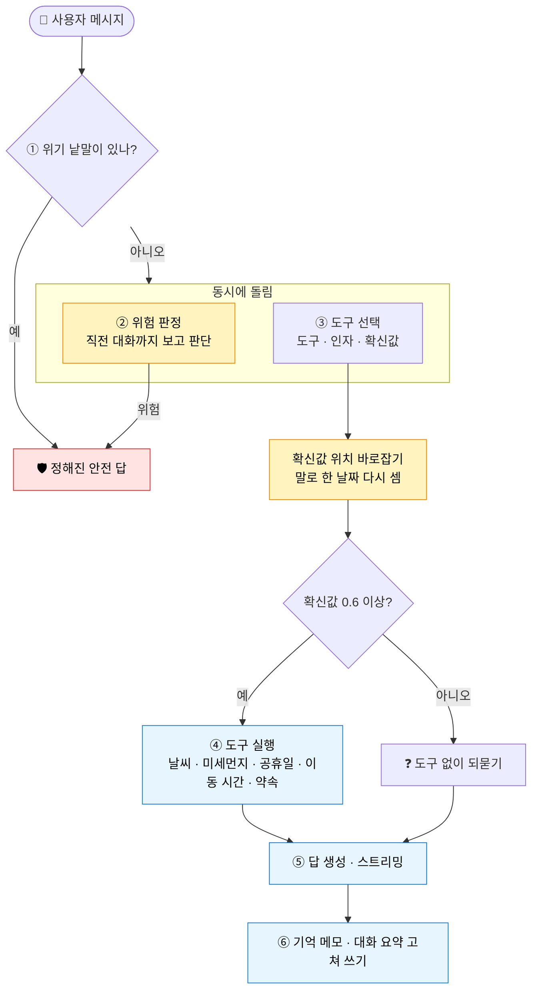
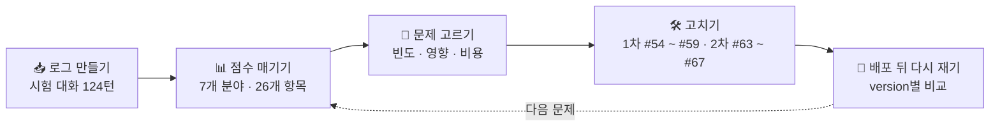
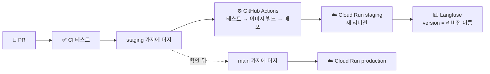

<div align="center">

# 🌤️ 하루친구 · AI 친구 에이전트

**내가 만든 캐릭터가 나를 기억하고, 필요하면 도구를 찾아 쓰고, 약속한 때가 되면 먼저 말을 거는 친구**

<br/>


<br/>


</div>

<br/>

> [!IMPORTANT]
> **📋 채점하시는 분께** — 15번 실습 「로그와 피드백으로 에이전트 개선하기」의 보고서는 **[REPORT.md](REPORT.md)** 입니다.
> 아래 표에서 보고 싶은 내용으로 바로 갈 수 있습니다.

| 보고 싶은 것 | 바로 가기 |
| --- | --- |
| 🔎 문제 후보 8개와 근거 트레이스 · 반복 횟수 | [REPORT 3장](REPORT.md#3-처음-잰-결과와-문제-후보) |
| ⚖️ 빈도 · 영향 · 비용으로 하나씩 고른 과정 | [REPORT 4장](REPORT.md#4-무엇을-먼저-고쳤나) |
| 🧪 문제 문장 · 정상 문장으로 잰 전후 비교 | [REPORT 5장](REPORT.md#5-고치기와-전후-비교) |
| 🔁 배포 뒤 새 대화를 version(리비전)별로 다시 잰 결과 | [REPORT 6장](REPORT.md#6-고친-뒤-다시-재기) |
| 🖼️ 트레이스 캡처로 보는 고치기 전 · 후와 version | [REPORT 6-7](REPORT.md#6-7-트레이스로-보는-전후) · [그림 폴더](docs/report-15) |
| 🔂 2차 개선: 셈법 바로잡기 · 남은 낮은 점수 고치기 · 다시 잰 결과 | [REPORT 7장](REPORT.md#7-2차-개선) |
| 🧑‍⚖️ 심사 모델을 얼마나 믿을 수 있나 · 남은 문제 | [REPORT 8장](REPORT.md#8-심사-모델을-얼마나-믿을-수-있나) · [9장](REPORT.md#9-남은-문제) |
| 🛠️ 고친 코드 | 1차 [#54](https://github.com/jubyeong-kim/friend-agent/pull/54) · [#55](https://github.com/jubyeong-kim/friend-agent/pull/55) · [#56](https://github.com/jubyeong-kim/friend-agent/pull/56) · [#58](https://github.com/jubyeong-kim/friend-agent/pull/58) · [#59](https://github.com/jubyeong-kim/friend-agent/pull/59) <br/> 2차 [#63](https://github.com/jubyeong-kim/friend-agent/pull/63) · [#64](https://github.com/jubyeong-kim/friend-agent/pull/64) · [#65](https://github.com/jubyeong-kim/friend-agent/pull/65) · [#66](https://github.com/jubyeong-kim/friend-agent/pull/66) · [#67](https://github.com/jubyeong-kim/friend-agent/pull/67) |

---

## ✨ 하루친구가 하는 일

| | 기능 | 설명 |
| :---: | --- | --- |
| 💬 | **캐릭터 대화** | 사용자가 정한 캐릭터가 답합니다. 답은 다 만들어지기 전부터 조금씩 흘러나옵니다(스트리밍) |
| 🧠 | **기억 3층** | 최근 대화 10턴 · 대화 요약 · 기억 메모를 함께 보고 답합니다. 메모는 답을 보낸 뒤 고쳐 씁니다 |
| 🧰 | **도구 7개** | 날씨 · 미세먼지 · 공휴일 · 대중교통 이동 시간 · 약속 저장 · 보기 · 취소 |
| ⏰ | **먼저 말 걸기** | 「목요일 아침에 우산 챙기라고 알려 줘」처럼 부탁한 약속은, 때가 된 뒤 앱을 열면 친구가 먼저 꺼냅니다 |
| 🛡️ | **안전장치** | 위기 낱말 규칙과 모델 위험 판정 둘로 살피고, 위험하면 캐릭터와 상관없이 정해진 안전 답을 보냅니다 |
| 📊 | **관측** | 턴마다 Langfuse 트레이스를 남깁니다. version 칸에 Cloud Run 리비전 이름을 적어, 어느 배포가 답했는지 알 수 있습니다 |

---

## 🧩 한 턴은 이렇게 흘러갑니다



<sub>🟨 노란 칸은 15번 실습에서 더한 단계입니다(PR #54 · #56 · #58, 「그날」 되묻기는 #64). 모델은 한 턴에 네 번 부릅니다: 위험 판정 · 도구 선택 · 답 · 기억 정리.</sub>

---

## 📈 15번 실습: 로그로 찾고, 고치고, 다시 재기



| 분야 | 처음 | 1차 뒤 | 2차 뒤 | 변화 |
| --- | :---: | :---: | :---: | :---: |
| 🛡️ 안전 | 77.1 | 91.7 | **100** | 🟢 +22.9 |
| 🧭 도구 선택 | 76.9 | 87.4 | **100** | 🟢 +23.1 |
| 🧰 도구 결과 쓰기 | 63.3 | **88.3** | 78.3 | 🟢 +15.0 |
| 🎭 답 · 캐릭터 | 91.7 | 91.7 | 83.3 | 🔴 −8.4 |
| 🧠 기억 | 100 | 88.3 | **100** | ⚪ 0 |
| 👋 첫 인사 | 100 | 100 | 100 | ⚪ 0 |
| ⚙️ 운영 | 75.8 | 82.7 | **92.1** | 🟢 +16.3 |
| **총합** | **83.5** | **90.0** | **93.4** | **🟢 +9.9** |

<sub>확신값 과신 항목의 바뀐 셈법과 사람 판정을 반영한 값입니다(REPORT 7-1 · 8장). 변화는 처음 → 2차 뒤.</sub>

| 고친 문제 | PR | 결과 |
| --- | :---: | --- |
| 도구 선택 출력이 깨져 맞는 도구를 버림 | #54 | 깨진 3개를 모두 바르게 읽음 · 정상 42개 그대로 |
| 연휴를 놓친 답 | #55 · #59 | 3번 중 0번 → 3번 중 2번 통과 |
| 말로 한 날짜를 틀리게 넣고도 확신함 | #56 | 틀린 날짜로 도구 실행 11번 → 0번 |
| 낱말 없이 이어지는 위기 질문에 답함 | #58 | 6번 중 4번 → 6번 모두 막음 |
| 「다음 공휴일」을 2주만 조회 · 「그날」에 되묻지 않음 | #64 | 새 문장 각 0/8 → 8/8 |
| 「자살골」 · 「극단적 다이어트」를 위기로 막음 | #65 | 일상 8문장 중 막힘 3 → 0 · 위기 문장은 그대로 막음 |
| 기억이 빠지거나 옛 사실이 남음 · 말하지 않은 날짜를 지어냄 | #63 · #66 | 7번 중 5번 → 7번 모두 통과 · 「다음 주 수술」은 기간으로 저장 |

> [!NOTE]
> 대신 **턴당 비용이 처음보다 32% 올랐고**(위험 판정 호출 · 길어진 지시문), 2차 뒤 「오늘은 여기까지 할게 잘 자」에 위기 안전 답이 나가는 오판이 새로 생겼습니다. 자세한 내용은 [REPORT 7장](REPORT.md#7-2차-개선) · [9장](REPORT.md#9-남은-문제)에 있습니다.

---

## 🚀 배포는 이렇게 흘러갑니다



---

## 🗂️ 폴더 한눈에

| 경로 | 내용 |
| --- | --- |
| `app/` | 서버 코드. 한 턴 흐름은 `agent.py`, 도구 선택은 `router.py`, 도구는 `tools.py`, 안전은 `safety.py` |
| `static/index.html` | 화면: 대화 · 캐릭터 설정 · 기억과 약속 · 개발용 「이번 턴」 패널 |
| `tests/` | 가짜 응답으로 돌리는 테스트 252개(비용 없음) |
| `data/eval/` · `scripts/` | 평가 데이터와 평가 · 운영 스크립트 |
| `docs/` | 운영 절차 · 배포 권한 · Supabase 연결 · 카나리 기준 |
| `REPORT.md` | 15번 실습 보고서 |

<br/>

<details>
<summary><b>📦 저장소 만들기 · 실행 · 환경변수 · 배포 · 외부 API 자세히 보기 (펼치기)</b></summary>

<br/>

## 저장소 만들기

이 저장소는 GitHub 템플릿 저장소입니다. 오른쪽 위의 **Use this template > Create a new repository** 를 눌러 내 계정에 **공개(Public)** 저장소로 만든 뒤, 내 노트북으로 내려받습니다.

```text
git clone https://github.com/<내 계정>/<저장소 이름>.git
cd <저장소 이름>
```

## 한 턴의 처리 흐름

```text
사용자 메시지
 ① 안전장치   위기 표현이면 캐릭터 설정과 상관없이 정해진 안전 응답 (코드 규칙)
              ②와 동시에 모델이 직전 대화까지 보고 위험을 한 번 더 판정. 위험하면 같은 안전 응답
 ② 도구 선택  모델이 도구(약속 저장 최대 5개, 다른 도구 최대 2개)와 인자, 확신도, 이유를 JSON으로 고름
              확신도 0.6 미만이면 도구 없이 되묻기. 모델이 없거나 실패하면 키워드 규칙
 ③ 도구 실행  날씨, 미세먼지, 공휴일(키 없는 공개 API), 이동 시간(카카오맵, 키 필요), 약속 저장, 보기, 취소
 ④ 답 생성    캐릭터 지시문 + 기억 메모 + 대화 요약 + 최근 10턴 + 도구 결과 → 스트리밍
 ⑤ 기억 정리  답을 다 보낸 뒤 같은 요청 안에서 기억 메모와 대화 요약을 갱신
```

**⑤를 응답 뒤 백그라운드로 돌리지 않는 이유:** Cloud Run 기본 설정(요청 기반 과금)에서는 응답을 보낸 뒤 CPU가 거의 주어지지 않습니다. 그래서 응답을 닫기 전에 처리합니다.

**호출 횟수와 비용:** 한 턴에 모델을 네 번 부릅니다(위험 판정, 도구 선택, 답, 기억 정리). 메시지 한 건의 원가를 계산할 때 네 번을 모두 셉니다.

## 구성

| 경로 | 내용 |
| --- | --- |
| `app/main.py` | 화면(`/`)과 API. 목록은 파일 맨 위 설명 참고 |
| `app/agent.py` | 한 턴의 처리 흐름(①~⑤)과 앱을 열 때 먼저 말 걸기 |
| `app/router.py` | 도구 선택기. 모델 선택, 키워드 규칙, 안전장치(확신도 기준, 연도 고치기) |
| `app/tools.py` | 도구 7개와 지원 도시 목록 |
| `app/memory.py` | 기억 3층(최근 대화, 대화 요약, 기억 메모) |
| `app/persona.py` | 캐릭터 설정 선택지와, 설정을 지시문으로 바꾸는 규칙. 고정 안전 규칙 |
| `app/safety.py` | 위기 표현과 민감 정보 규칙 |
| `app/when.py` | 날짜, 시각 표현 해석과 달력 |
| `app/auth.py` | 요청한 사용자 확인(로그인 없음 또는 Supabase Auth) |
| `app/store/` | 저장소. `memory_store.py`(서버 메모리), `supabase_store.py`(Supabase) |
| `app/llm.py` | LLM 호출(OpenAI, Gemini, 가짜 응답) |
| `app/config.py` | 설정 읽기. 꼭 필요한 값이 없으면 시작하지 않는다 |
| `static/index.html` | 화면: 대화, 캐릭터 설정, 기억과 약속, 개발용 "이번 턴" 패널 |
| `supabase/migrations/` | Supabase 테이블 생성 SQL |
| `data/eval/` | 평가 데이터: 도구 선택 46개, 기억 정리 15개, 안전 15개 |
| `scripts/eval_tools.py` | 도구 선택 평가 |
| `scripts/watch_requests.py` | 배포 중 끊김 측정. `/version` 에 0.2초마다 요청하고 리비전별 응답 수와 실패 수를 요약(최대 5분, AI 호출 없음) |
| `scripts/health_check.py` | 내 컴퓨터 Nginx 실습용 능동 헬스체크. 서버마다 `/health` 를 5초마다 확인해, 연속 2번 실패하면 upstream 에서 빼고 연속 2번 성공하면 다시 넣는다(`nginx -t` 통과 때만 reload) |
| `tests/` | 가짜 응답으로 돌리는 테스트 |
| `hello/` | 배포 연습용 최소 앱(AI를 부르지 않음) |
| `Procfile` | Cloud Run이 앱을 시작할 때 쓰는 명령 |
| `AGENTS.md`, `CLAUDE.md` | 코딩 에이전트와 사람이 지키는 작업 규칙 |
| `.claude/settings.json` | 코딩 에이전트(Claude Code)가 실행하지 못하는 명령과 매번 묻는 명령 |
| `docs/` | 동작 예시(`examples.md`), 실습별 시작 상태(`start-states.md`), 배포 기록 양식, Supabase 연결 절차, GitHub Actions 배포 권한 절차(`wif-setup.md`), 운영 절차(`runbook.md`)와 카나리 판단 기준(`canary-criteria.md`) 양식 |
| `starter/` | 실습 단계마다 꺼내 쓰는 워크플로, Dockerfile 예시, 일부러 넣어 보는 변경(`starter/README.md`) |
| `data/samples/` | 사진 글자 읽기 실습용 일정표 사진 |

## 환경변수

| 이름 | 값 | 설명 |
| --- | --- | --- |
| `LLM_PROVIDER` | `openai`, `gemini`, `claude`, `fake` | 기본값 `openai`. `fake` 는 키 없이 가짜 응답을 돌려준다. `claude` 의 기본 모델은 `claude-opus-5-5` 이고, `LLM_MODEL=claude-haiku-5-5` 처럼 바꿀 수 있다 |
| `LLM_API_KEY` | AI 회사 API 키 | `fake` 가 아니면 필수. 없으면 앱이 시작하지 않는다 |
| `LLM_MODEL` | 모델 이름 | 비우면 제공자별 기본값(`gpt-4o-mini` 등)을 쓴다 |
| `ENV` | `local`, `staging`, `production` | `staging` 이면 화면 위에 테스트 환경 표시. `production` 이면 개발용 패널이 기본으로 꺼짐 |
| `SHOW_TURN_PANEL` | `true`, `false` | 개발용 "이번 턴" 패널. 기본값은 production 에서만 꺼짐 |
| `STORAGE` | `memory`, `supabase` | 기본값 `memory`(서버 메모리. 재배포하면 사라짐) |
| `AUTH` | `none`, `supabase` | 기본값 `none`(로그인 없음, 모든 요청이 개발용 사용자 한 명) |
| `SUPABASE_URL` | `https://<프로젝트>.supabase.co` | `AUTH=supabase` 일 때 필수 |
| `SUPABASE_PUBLISHABLE_KEY` | `sb_publishable_...` | 브라우저에 공개해도 되는 키. 로그인에만 쓴다 |
| `SUPABASE_SECRET_KEY` | `sb_secret_...` | `STORAGE=supabase` 일 때 필수. RLS를 건너뛰는 키라서 Secret Manager에 둔다 |
| `GOOGLE_LOGIN` | `true`, `false` | 구글 계정 연결 버튼 표시 |
| `OCR_ENABLED` | `true`, `false` | 사진 글자 읽기(📷 버튼). 글자 읽기 모델 파일 두 개가 있어야 한다(아래 「단계별로 켜는 기능」) |
| `OCR_MODEL_DIR` | 폴더 경로 | 글자 읽기 모델 파일이 있는 폴더. 기본값 `/opt/ocr-models`(Dockerfile 이 넣는 곳). 노트북에서는 `.ocr-models` 처럼 받은 폴더를 적는다 |
| `COMMIT_SHA` | 커밋 해시 | `/version` 에 표시된다. 자동 배포에서 넣는다 |
| `BANNER` | 짧은 문구 | 화면 위에 띠로 보이고 `/version` 에도 나온다. 이미지를 새로 만들지 않고 새 리비전을 만들어 볼 때 쓴다 |
| `SLOW_START_SECONDS` | 초 | 배포 실습용 시작 지연. 포트는 바로 열지만 이 시간 동안 모든 요청(`/health` 포함)에 503을 돌려준다. 기본값 0 |

`STORAGE=supabase` 는 `AUTH=supabase` 와 함께 써야 합니다. 로그인 없이 DB에 저장하면 모든 사용자의 데이터가 한 사람 것으로 섞이므로, 앱이 시작하지 않습니다.

## 노트북에서 실행하기

```text
python -m venv .venv
source .venv/bin/activate        # Windows: .venv\Scripts\activate
pip install -r requirements.txt

cp .env.example .env             # .env 를 열어 값을 채운다. 처음에는 LLM_PROVIDER=fake 로 두어도 된다
uvicorn app.main:app --port 8080
```

1. 브라우저에서 `http://localhost:8080` 을 열면 캐릭터 만들기 화면이 나옵니다.
2. 저장하면 캐릭터가 먼저 말을 겁니다.
3. 오른쪽 "이번 턴" 패널에서 메시지마다 아래 내용을 볼 수 있습니다.
   - 고른 도구, 확신도, 이유, 작동한 안전장치
   - 도구 결과
   - 답에 넣은 기억
   - 새로 기억한 것
   - 걸린 시간

`LLM_PROVIDER=fake` 이면 모델 대신 키워드 규칙이 도구를 고르고, 답은 "(가짜 응답)"으로 시작하는 짧은 문장입니다. `.env` 는 노트북에서 실행할 때만 읽고, 저장소와 배포에는 올라가지 않습니다(`.gitignore`, `.gcloudignore`).

## 테스트와 평가

```text
pip install -r requirements-dev.txt
pytest                                  # 가짜 응답으로 실행. 비용 없음
python scripts/eval_tools.py --rule     # 키워드 규칙 도구 선택 평가. 비용 없음
python scripts/eval_tools.py            # .env 의 모델로 도구 선택 평가. 호출 46번
```

템플릿을 만들 때 잰 결과입니다(2026-10-12).

| 선택기 | 도구 정답 | 도구와 인자 모두 정답 |
| --- | --- | --- |
| 모델 `gpt-4o-mini` (3회 실행) | 37~39 / 41 | 35~36 / 41 |
| 키워드 규칙 | 37 / 41 | 36 / 41 |
| 키워드 규칙, 약속·이동 시간 문항 5개 추가 뒤(2026-10-21) | 42 / 46 | 41 / 46 |

**모델이 자주 틀린 것**
- "아침"을 08:00이 아니라 09:00으로 잡음
- "금요일 시험 전날"을 수요일로 계산함
- 지난 연도(2023)로 날짜를 씀. 이 경우는 코드 안전장치가 올해로 고칩니다.
- 묻지 않은 도구를 덧붙임

**키워드 규칙이 틀린 것**
- "우산 잃어버렸어", "지난 공휴일에 캠핑 갔었어"처럼 단어만 같고 뜻이 다른 문장
- "그럼 모레는?" 같은 이어지는 질문

같은 데이터로 돌려도 모델 결과는 실행마다 조금씩 다릅니다.

## Cloud Run에 배포하기

```text
# hello 앱 (hello/ 폴더 안에서)
gcloud run deploy hello --source . --region us-central1 --allow-unauthenticated

# 에이전트 서비스 (저장소 루트에서)
gcloud run deploy friend-agent --source . --region us-central1 --allow-unauthenticated
```

에이전트 서비스는 `LLM_API_KEY` 가 없으면 시작하지 않으므로, 키를 넣기 전 첫 배포는 실패합니다. 키를 넣는 방법과 Secret Manager 연결은 교안을 따라 진행합니다.

## 단계별로 켜는 기능

처음 배포할 때는 서버 메모리에 저장하고 로그인이 없습니다. 아래 기능은 해당 주제를 배우는 날 켭니다.

| 기능 | 켜는 방법 | 필요한 것 |
| --- | --- | --- |
| 재배포해도 남는 저장, 사용자별 데이터 | `STORAGE=supabase`, `AUTH=supabase` | Supabase 프로젝트, 익명 로그인 켜기. 절차는 `docs/supabase.md`. 동료에게 공개하기 전에 구글 로그인과 함께 붙인다 |
| 구글 계정 연결 | `GOOGLE_LOGIN=true` | Supabase 구글 로그인 설정, 수동 연결(manual linking) 켜기 |
| 이동 시간(대중교통) | `KAKAO_REST_KEY` (Secret Manager 로 연결) | 카카오 디벨로퍼스 앱, [카카오맵] 사용 설정. 키가 없으면 이 도구만 꺼진다 |
| 사진 글자 읽기 | `OCR_ENABLED=true` | PaddleOCR 공개 모델 파일 두 개(약 23MB, Apache-2.0). 서버: Dockerfile 이 이미지에 넣는다. 노트북: 아래처럼 받는다 |
| 앱을 닫아 둬도 오는 약속 알림 | 아직 없음 | Cloud Scheduler, 웹 푸시, PWA |

사진 글자 읽기는 RapidOCR(onnxruntime)로 글자 위치 찾기(PP-OCRv6_det_small) → 한국어 인식(korean_PP-OCRv5_rec_mobile) 순서로 돌립니다. 거꾸로(180도) 든 사진은 읽지 못합니다(이유는 `app/ocr.py` 맨 위). 서버는 실행 중에 모델을 내려받지 않습니다. 노트북에서 켜려면 저장소 루트에서 Dockerfile 의 `ADD` 줄과 같은 주소로 받고, `.env` 에 `OCR_MODEL_DIR=.ocr-models` 를 적습니다(`.ocr-models/` 는 저장소와 이미지에 올라가지 않습니다).

```text
mkdir .ocr-models
curl -L -o .ocr-models/PP-OCRv6_det_small.onnx https://www.modelscope.cn/models/RapidAI/RapidOCR/resolve/v3.10.0/onnx/PP-OCRv6/det/PP-OCRv6_det_small.onnx
curl -L -o .ocr-models/korean_PP-OCRv5_rec_mobile.onnx https://www.modelscope.cn/models/RapidAI/RapidOCR/resolve/v3.10.0/onnx/PP-OCRv5/rec/korean_PP-OCRv5_rec_mobile.onnx
```

모델 파일이 있으면 `pytest` 가 일정표 사진(`data/samples/schedule.png`)을 실제로 읽어 보는 테스트도 돌립니다. 없으면 그 테스트만 건너뜁니다.

## 외부 API

| 도구 | API | 조건 |
| --- | --- | --- |
| 날씨, 미세먼지 | [Open-Meteo](https://open-meteo.com/) | 키 없음. 비상업적 사용 무료, 하루 1만 건 이하 권장. 상용 서비스는 유료 플랜 필요 |
| 공휴일 | [Nager.Date](https://date.nager.at/) | 키 없음 |
| 이동 시간 | [카카오맵 REST API](https://developers.kakao.com/docs/ko/kakaomap/rest-api) 키워드 장소 검색 + 대중교통 경로 | REST API 키. 하루 무료 장소 검색 10만 건, 대중교통 1천 건(계정에서 처음 켠 앱에만). 출발 시각은 넣을 수 없어 걸리는 시간만 받는다. 결과는 저장하지 않고 매번 부른다 |

공개 지오코딩 API는 한국어 지명을 잘못 찾는 경우가 있어서, 지원 도시 26곳의 좌표를 `app/tools.py` 에 직접 적어 두었습니다.

</details>

<br/>

<sub>이 저장소는 jubyeong-kim 이 Cloud Run 배포 실습용으로 만들었다.</sub>
